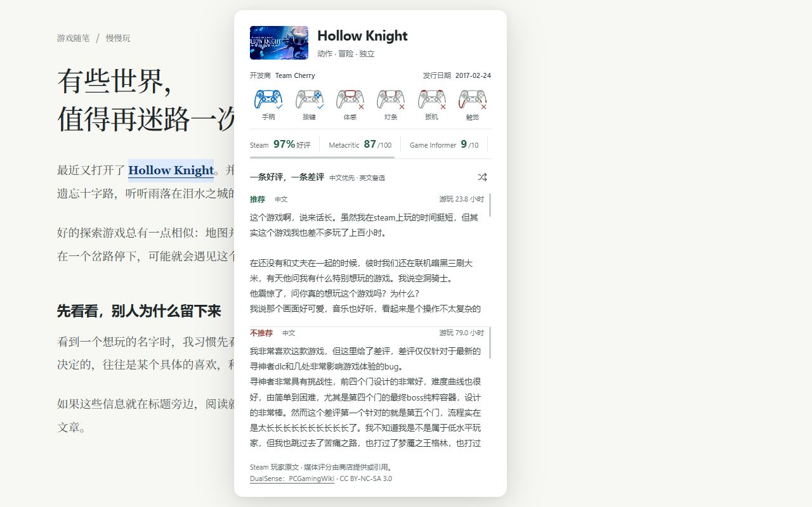

# Game Quick Reviews

Quick, same-page Steam game scores and helpful player reviews.

Enable the toolbar switch and select a full game title. Read developer, release date, genre, scores, controller support, and one positive and one negative review without leaving the page. Chinese reviews are preferred, with English fallback. Reviews scroll independently. Click the game title to open Steam.

Free, noncommercial, no account, ads or analytics. This extension is independent of Valve, Sony and Microsoft.

[Privacy policy](PRIVACY.md) · [Report a problem](https://github.com/cyrilkong/game-quick-reviews-public/issues)

Support: cyril.kong@gmail.com

Chrome Web Store status: Initial 1.0.0 listing is being prepared. The install link will be added once publication is confirmed.
